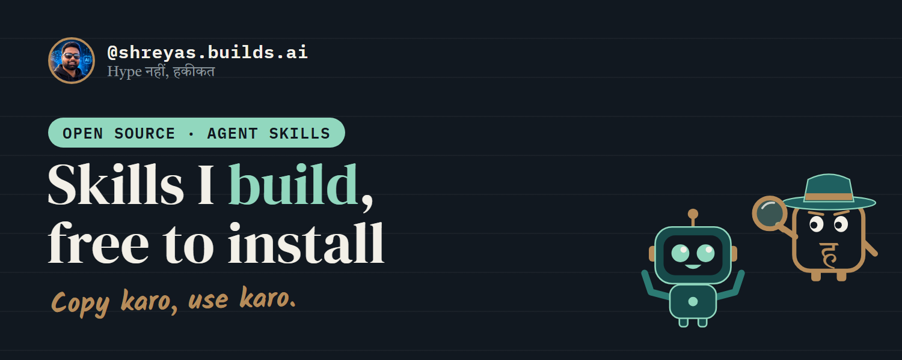

<p align="center">
  
</p>

# skills

Free AI skills from [@shreyas.builds.ai](https://www.instagram.com/shreyas.builds.ai). *Hype nahi, hakikat.*

I'm Shreyas, a senior AI/ML engineer. On Instagram I check AI claims and show what actually works, for students and working professionals in India. When a reel or carousel ends with "comment KEYWORD" and promises a tool, this is where the tool lives.

## What is a skill?

A skill is a folder with a `SKILL.md` file in it: plain-English instructions, plus reference files when needed. You install it once, and your AI loads it when your request matches. After that you just ask.

Nothing is hidden. Open any `SKILL.md` and you can read every word the AI will read.

## Skills

| Skill | What it does | Works with |
|---|---|---|
| [**Prompter**](prompter/) | Write a rough idea in English, Hindi or Hinglish and get a ready-to-paste prompt back, with one line on why each change works. Commands: `/prompt`, `/fix`, `/img`, `/codes` | Claude (claude.ai and Claude Code), plus a ChatGPT version for Custom Instructions |

More are coming. Follow [@shreyas.builds.ai](https://www.instagram.com/shreyas.builds.ai) to hear when a new one drops.

## Install

### One command (Claude Code and other coding agents)

```bash
npx skills add shreyas-builds-ai/skills --skill prompter
```

Needs [Node.js](https://nodejs.org). The [skills CLI](https://skills.sh) finds the skill in this repo and installs it for the agents on your machine. Swap `prompter` for any skill name in the table above.

### By hand (Claude Code)

Copy the inner skill folder (for Prompter, that's `prompter/prompter/`) into:

- `~/.claude/skills/` to use it in every project, or
- `.claude/skills/` inside one project.

### claude.ai (the free plan works)

Every skill has a ZIP on the [Releases](../../releases) page. Upload that ZIP, not the one from GitHub's green **Code → Download ZIP** button, which has the wrong folder layout and fails. The step-by-step guide is in each skill's README: [Prompter on claude.ai](prompter/README.md#install-the-skill-on-claudeai-free-plan-works).

### ChatGPT

ChatGPT doesn't load skill folders. When a skill has a ChatGPT version, it sits in that skill's folder, ready to paste into Custom Instructions. For Prompter: [chatgpt-codes.md](prompter/chatgpt-codes.md).

## House rules

Every skill in this repo:

1. **Is plain text you can read.** No hidden prompts, no tracking, no API keys.
2. **Promises no magic.** No "GODMODE", no secret codes, no "unlock". A skill works because its instructions are clear, and that's all.
3. **Is tested before it goes up.** I run it on real tasks first. If it doesn't hold up, it doesn't ship.
4. **Understands how you talk.** Ask in English, Hindi or Hinglish.
5. **Is free.** Each skill carries its own licence.

## Repo layout

```
skills/
├── README.md                you are here
├── assets/banner.png
└── prompter/
    ├── README.md            install and usage guide
    ├── LICENSE
    ├── chatgpt-codes.md     ChatGPT version
    └── prompter/            the skill folder you install
        ├── SKILL.md
        └── references/
```

Every new skill follows the same shape: `<name>/README.md` for people, `<name>/<name>/SKILL.md` for the AI.

## Found a problem?

Open an [issue](../../issues) with what you asked, what you expected and what you got. Or DM me on Instagram.

## Licence

Each skill has its own `LICENSE` file. Prompter is MIT.

---

<p align="center">
  Made by <a href="https://www.instagram.com/shreyas.builds.ai"><b>@shreyas.builds.ai</b></a> · Hype नहीं, हकीकत
</p>
